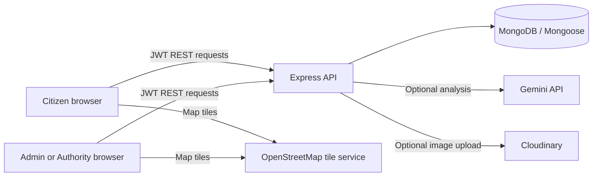

# JAN Voice AI

JAN Voice AI is a buildathon prototype for submitting civic reports and managing their status inside one application. It combines citizen reporting, optional AI assistance, and an admin/authority workflow. It is not connected to a municipality, government service, emergency service, or official complaint-delivery channel.

## Problem statement

Civic concerns can be difficult to describe clearly and difficult for a reporter to follow after submission. This project explores how voice-to-text, structured suggestions, optional location, and a visible report history could make a digital reporting workflow easier to use and manage. This is a product hypothesis; the repository contains no field research or outcome data that validates its impact.

## Proposed solution

Citizens can write a report or dictate an editable transcript, attach an image, and optionally share GPS. Gemini can suggest report details for a citizen to review or edit. A possible-duplicate check can show related report references without merging or rejecting anything. Admins and authorities manage assignment and status within JAN Voice AI; citizens see the saved status history and staff updates.

## Features currently implemented

- Citizen registration, login, JWT authentication, and role-specific protected routes. Public registration creates Citizen accounts only.
- Citizen complaint submission with text, JPEG/PNG/WebP image upload, optional browser speech transcript, optional GPS, an urgent flag for staff, and client-visible validation/errors.
- Backend-validated Gemini suggestions for category, department, priority, summary, language, and explanation. Citizens can review, edit, accept, or reject suggestions. AI output is advisory.
- Similar-report warnings based on complaint text, category, and geographic proximity when coordinates are available. Reports are kept separate.
- MongoDB-backed complaints, pagination, citizen statistics, status history, and notifications.
- Citizen-owned report retrieval and editing. Staff APIs enforce role and authority department scope.
- Admin workflow to assign departments to existing Authority accounts; Authority/Admin workflows to record status and remarks.
- Approximate map markers for reports with shared coordinates, using OpenStreetMap tiles and attribution.
- Bounded report queues, loading/error/empty states, and a database-aware `/api/health` endpoint.

## Known limitations

- Complaint status and staff remarks are recorded only in JAN Voice AI. They do not mean a government office received, verified, or resolved a complaint.
- There is no government, emergency-service, email, SMS, push-notification, or external ticketing integration. Password reset email delivery is unavailable.
- Gemini and Cloudinary require backend credentials. Without Gemini, reports can still be submitted without AI suggestions. Image upload requires all Cloudinary settings.
- Browser speech recognition and geolocation vary by browser and permissions. The app sends the transcript, not a raw recording; speech recognition behavior depends on the browser.
- OpenStreetMap tiles require network access and are best-effort. Map markers are approximate; there are no invented coordinates for reports without GPS.
- Duplicate detection is a heuristic and can produce false positives or miss similar reports. It is only a warning.
- Admin and Authority accounts are not created by public signup. They must be provisioned for a staging/demo environment through a trusted process; there is no account provisioning UI or included seeder.
- Rate limits are process-local. Production multi-instance use needs a shared limiter store. No hosting manifest or CI/CD pipeline is included.
- The app has not been validated with real civic users, a live public-service workflow, production traffic, or measured impact.

## Technology stack

- Frontend: React, TypeScript, Vite, React Router, Axios, Tailwind CSS.
- Backend: Node.js, Express, TypeScript, express-validator, Multer.
- Data: MongoDB and Mongoose. MongoDB is the source of truth for complaints and their histories.
- AI: Google Gemini API, called by the backend only.
- Images: Cloudinary, called by the backend only.
- Authentication: JWT and bcrypt.
- Mapping: OpenStreetMap raster tiles; no frontend map API key is required.

## Architecture overview



The frontend uses typed API helpers. Backend routes validate requests, authenticate the JWT, authorize the role, enforce ownership or department scope, and call services that read and write MongoDB. Gemini analysis produces a validated response and receipt; report submission verifies that receipt before persisting the reviewed AI state. Browser environment variables use the `VITE_` prefix and must never contain backend secrets.

## Requirements

- Node.js 20 or later.
- npm 10 or later.
- A MongoDB database for backend operation.
- Optional: a Gemini API key for live analysis.
- Optional: a Cloudinary account for image uploads.

## Installation and environment setup

1. From the repository root, install dependencies:

   ```sh
   npm install
   ```

2. Copy `backend/.env.example` to `backend/.env`. Set `MONGODB_URI` to a dedicated development or staging database, and set `JWT_SECRET` to a private random value of at least 32 characters for production. Never commit `.env` files.

3. Add `GEMINI_API_KEY` only when enabling live Gemini analysis. Add `CLOUDINARY_CLOUD_NAME`, `CLOUDINARY_API_KEY`, and `CLOUDINARY_API_SECRET` together to enable image uploads. These credentials remain backend-only.

4. Copy `frontend/.env.example` to `frontend/.env`. `VITE_API_BASE_URL` defaults to `http://localhost:5000`. `VITE_MAP_TILE_URL` is an optional OSM-compatible tile template. Do not put private credentials in `VITE_*` values because Vite embeds them in browser assets.

5. Start the frontend and backend from the repository root:

   ```sh
   npm run dev
   ```

   The frontend defaults to `http://localhost:5173`; the backend defaults to `http://localhost:5000`. The backend connects to MongoDB before it starts listening. Check `http://localhost:5000/api/health` for database readiness.

For an isolated, synthetic demo workflow and the staff-account prerequisite, see [docs/buildathon-demo-setup.md](docs/buildathon-demo-setup.md).

## Quality commands

Run from the repository root:

```sh
npm test --workspace=@janvoice/backend
npm test --workspace=@janvoice/frontend
npm run typecheck --workspace=@janvoice/backend
npm run typecheck --workspace=@janvoice/frontend
npm run lint --workspace=@janvoice/backend
npm run lint --workspace=@janvoice/frontend
npm run build --workspace=@janvoice/backend
npm run build --workspace=@janvoice/frontend
git diff --check
```

Backend tests use model/API stubs; they do not require or prove behavior against a live MongoDB database. Frontend Node tests cover speech-recognition helpers and API query building, not rendered browser screens.

## Demo workflow

Use the checklist in [docs/buildathon-demo-setup.md](docs/buildathon-demo-setup.md). The short flow is: register a Citizen, submit a synthetic civic report, optionally review Gemini suggestions and share GPS, inspect any duplicate warning, log in to a pre-provisioned test Admin, assign an existing test Authority department, record a status update as that Authority, then verify the Citizen timeline and notifications. Do not present synthetic demo reports as resident reports or government outcomes.

## Future scope

- Research with citizens and service teams; measure task completion, accessibility, and report quality before claiming impact.
- Add a reviewed, secure process for provisioning and managing Authority/Admin accounts.
- If a government partner exists, design an explicit, consented integration with delivery receipts and clear ownership of official status.
- Evaluate duplicate-detection quality on a consented, representative dataset and improve language/localization support.
- Add configured email-based account recovery, operational monitoring, shared rate limiting, deployment automation, and production-grade map hosting.

## Buildathon presentation

See [docs/buildathon-presentation-outline.md](docs/buildathon-presentation-outline.md) for an eight-part presentation outline that avoids unsupported traction and outcome claims.
